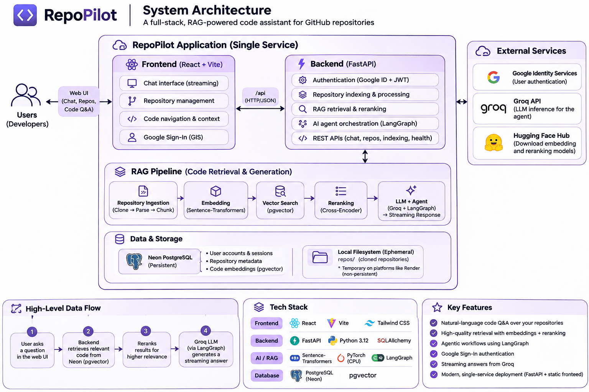

# RepoPilot

**RepoPilot is an AI-powered repository intelligence assistant that helps developers understand, explore, and ask questions about unfamiliar GitHub codebases.**

It combines repository analysis, structural code chunking, vector retrieval, cross-encoder reranking, and an LLM-powered LangGraph workflow to produce answers grounded in repository evidence.

## System Architecture



## What RepoPilot Does

- **Repository indexing:** Clone a Git repository and analyze its structure, technologies, and supported source files.
- **Code-aware processing:** Read source files and split them into structurally meaningful chunks, retaining metadata such as file path, language, symbol, and line information.
- **Semantic search:** Generate 384-dimensional embeddings with `all-MiniLM-L6-v2` and store them in PostgreSQL using `pgvector`.
- **Relevant-context ranking:** Retrieve candidate chunks and rerank them with `cross-encoder/ms-marco-MiniLM-L-6-v2`.
- **Repository Q&A:** Ask natural-language questions about an indexed repository and receive answers grounded in retrieved code context.
- **Evidence visibility:** Inspect the source files, symbols, line ranges, and retrieved snippets used to support an answer.
- **Streaming investigation:** Follow the question lifecycle in the UI as context is retrieved, evidence is evaluated, and an answer is generated.
- **Persistent conversations:** Create, revisit, rename, and delete chat sessions associated with indexed repositories.
- **Authentication:** Sign in with Google Identity Services; the backend verifies credentials and manages cookie-based sessions with CSRF protection.

## RAG and Answer Generation

The current question-answering path is:

1. The user selects an indexed repository and asks a question.
2. The backend embeds the question using `all-MiniLM-L6-v2`.
3. `VectorStore` performs a repository- and user-scoped similarity search in PostgreSQL/pgvector, retrieving up to 10 candidates.
4. The cross-encoder reranks the candidates and selects the top 5 chunks.
5. LangGraph orchestrates retrieval followed by answer generation.
6. The Groq-hosted `openai/gpt-oss-20b` model generates an answer using the retrieved context. If the context is empty or the model indicates insufficient evidence, RepoPilot returns a fallback response rather than inventing repository details.
7. The API streams investigation-stage updates and returns the answer with its evidence.

> The current graph uses a direct retrieve → answer workflow. The earlier separate relevance-grading and query-rewrite/retry path was removed as part of latency optimization. Evidence sufficiency is handled in the answer step.

## Repository Indexing Pipeline

The indexing workflow currently performs:

1. Clone or reuse the repository in the local `repos/` directory.
2. Analyze repository structure and detect technologies.
3. Discover and read supported source files and documentation.
4. Structurally chunk source code while retaining useful source metadata.
5. Generate embeddings with Sentence Transformers.
6. Persist chunks and vectors in PostgreSQL/pgvector.

Repository indexing is initiated through the FastAPI API and reports progress through indexing-job status endpoints.

## Technology Stack

| Layer | Technologies |
|---|---|
| Frontend | React, TypeScript, Vite |
| Backend | Python, FastAPI, Pydantic |
| AI orchestration | LangChain, LangGraph |
| Embeddings | Sentence Transformers, `all-MiniLM-L6-v2` |
| Reranking | Sentence Transformers CrossEncoder, `cross-encoder/ms-marco-MiniLM-L-6-v2` |
| LLM | Groq API, `openai/gpt-oss-20b` |
| Database | Neon PostgreSQL, SQLAlchemy, pgvector |
| Code parsing | Tree-sitter |
| Authentication | Google Identity Services, JWT-based sessions, secure cookies, CSRF protection |

## Current Project Progress

### Implemented

- [x] React + TypeScript frontend
- [x] FastAPI backend and REST endpoints
- [x] Google sign-in and backend credential verification
- [x] Cookie-based authentication and CSRF protection
- [x] Repository cloning and indexing workflow
- [x] Repository structure and technology analysis
- [x] Source-file discovery and structural code chunking
- [x] Sentence Transformer embeddings
- [x] PostgreSQL + pgvector vector storage
- [x] User- and repository-scoped vector retrieval
- [x] Cross-encoder reranking
- [x] LangGraph retrieval-and-answer workflow
- [x] Evidence-backed answers with source metadata
- [x] Streaming question progress and responses
- [x] Persistent chat sessions and conversation history
- [x] Shared model initialization during API application startup
- [ ] Deployment-oriented frontend serving and production configuration

### Performance and reliability work

- Shared embedding, reranking, and LLM clients across API requests within a worker.
- Batched cross-encoder predictions (default batch size: 4).
- Reused the request-scoped SQLAlchemy session in vector search.
- Reduced vector-search payload to the columns required by retrieval.
- Simplified the graph from a multi-call grading/rewrite/retry flow to retrieve → answer to reduce LLM round trips.
- Added focused lifecycle, graph, API, and production-serving tests.

### Retrieval benchmark

A benchmark was run against the `DL_Watermarking` repository:

- 14 questions evaluated
- 12 supported questions and 2 intentionally unsupported questions
- Mean concept coverage on supported questions: **88.2%**
- Median per-question retrieval latency: **approximately 2.44 seconds**

The benchmark also highlighted areas for further work, including ranking consistency for some questions and stronger end-to-end abstention evaluation for unsupported questions. These results are a project snapshot, not a guarantee of answer accuracy.

## Running Locally

### Prerequisites

- Python 3.12 recommended
- Node.js and npm
- Git
- A PostgreSQL database with the pgvector extension (Neon PostgreSQL can be used)
- Google OAuth / Identity Services client ID
- Groq API key

### Backend

Create and activate a virtual environment, then install the project dependencies:

```bash
python -m venv venv

# Windows PowerShell
.\venv\Scripts\Activate.ps1

# macOS / Linux
source venv/bin/activate

pip install -r requirements.txt
```

Configure the required environment variables using your local environment configuration. At minimum, the backend needs:

```env
DATABASE_URL=your_postgresql_connection_string
GROQ_API_KEY=your_groq_api_key
GOOGLE_CLIENT_ID=your_google_client_id
REPOPILOT_AUTH_SECRET=your_long_random_secret
```

Start the API from the repository root:

```bash
uvicorn app.api:app --reload
```

### Frontend

In another terminal:

```bash
cd frontend
npm ci
npm run dev
```

The Vite development server proxies `/api` requests to the local FastAPI backend. Set `VITE_GOOGLE_CLIENT_ID` in the frontend environment to the same Google client ID used by the backend.

> Never commit `.env` files, API keys, database credentials, or authentication secrets.

## Deployment Status

The application has been prepared for a single-service deployment in which FastAPI serves the built React frontend and API from the same origin.

A Render build completed successfully, but the service exceeded the memory limit of the 512 MB instance while loading the embedding and reranking models during startup. The project is therefore **not currently running as a public production deployment**.

The embedding and reranking models have intentionally been retained; reducing or removing them solely to fit a restrictive free hosting tier is not part of the current plan.

Repository clones are stored under the local `repos/` directory. On ephemeral hosting filesystems, those clones do not survive instance replacement or redeployment. Neon PostgreSQL remains the persistent source of truth for application data and indexed vectors.

## Repository Structure

```text
Repo-Pilot/
├── app/                 # FastAPI backend, indexing, retrieval, graph and auth
├── frontend/            # React + TypeScript + Vite application
├── tests/               # Backend and workflow tests
├── repos/               # Local repository clones (runtime data)
├── requirements.txt     # Development environment dependencies
├── requirements-render.txt
└── README.md
```

## Future Directions

- Improve retrieval ranking consistency across different repository question types.
- Expand end-to-end evaluation for unsupported questions and abstention behavior.
- Revisit vector indexing strategies as repository chunk volume grows.
- Explore durable storage for repository clones if persistent hosted indexing is required.
- Continue improving observability, latency, and reliability without compromising retrieval quality.

---

**RepoPilot** — making unfamiliar codebases easier to understand.
